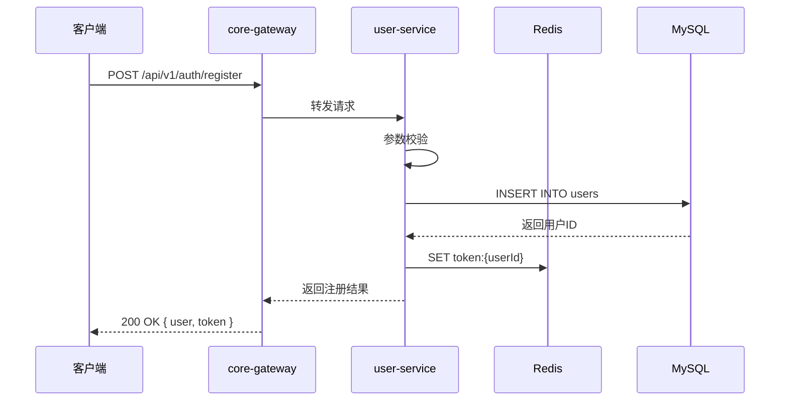
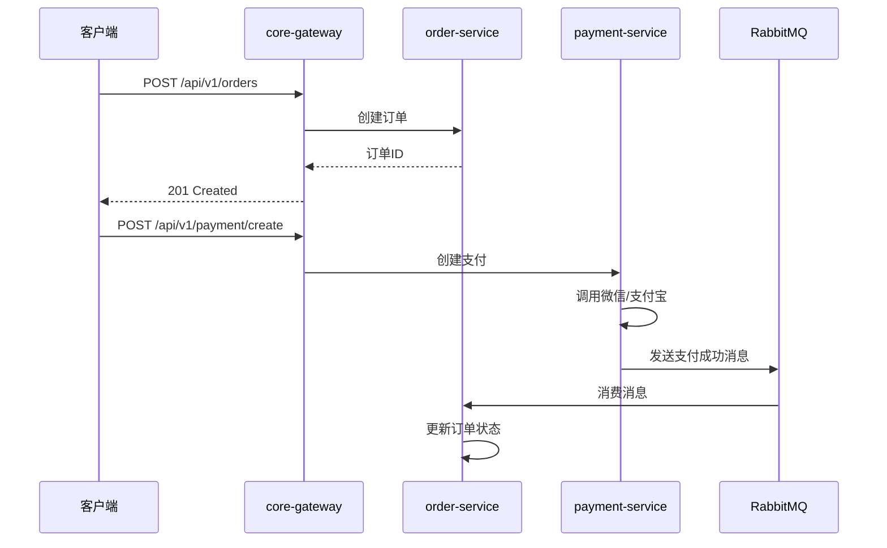

# 集成测试与端到端测试体系建设指南

## 1. 测试场景梳理

### 1.1 核心业务流程

| 业务流程 | 覆盖模块 | 测试优先级 |
|----------|----------|------------|
| 用户注册/登录 | user-service, core-gateway | P0 |
| 商品浏览/搜索 | product-service, search-service | P0 |
| 订单创建/支付 | order-service, payment-service | P0 |
| 营销活动参与 | marketing-service | P1 |
| 版权申请 | copyright-service | P1 |
| 社区互动 | community-service | P2 |

### 1.2 测试场景清单

#### 场景 1: 用户注册登录流程



**测试用例:**
- 正常注册流程
- 重复注册（已存在手机号）
- 密码强度不足
- 缺少必填字段

#### 场景 2: 订单支付流程



**测试用例:**
- 正常下单支付流程
- 库存不足下单
- 支付超时
- 重复支付

## 2. 集成测试实施

### 2.1 契约测试

使用 Pact 进行服务间契约测试：

```java
// Consumer 测试 (order-service)
@ExtendWith(PactConsumerTestExt.class)
public class PaymentServiceConsumerTest {
    
    @Pact(provider = "payment-service", consumer = "order-service")
    public RequestResponsePact createPaymentPact(PactDslWithProvider builder) {
        return builder
            .given("payment service is available")
            .uponReceiving("a request to create payment")
            .path("/api/v1/payments")
            .method("POST")
            .body("{\"orderId\":\"123\",\"amount\":100.00}")
            .willRespondWith()
            .status(201)
            .body("{\"paymentId\":\"pay-123\",\"status\":\"PENDING\"}")
            .toPact();
    }
    
    @Test
    @PactTestFor(pactMethod = "createPaymentPact")
    void testCreatePayment(MockServer mockServer) {
        PaymentServiceClient client = new PaymentServiceClient(mockServer.getUrl());
        PaymentResponse response = client.createPayment(new PaymentRequest("123", 100.00));
        assertEquals("pay-123", response.getPaymentId());
    }
}
```

### 2.2 数据流转测试

```java
@SpringBootTest
@ActiveProfiles("test")
public class OrderDataFlowTest {
    
    @Autowired
    private OrderService orderService;
    
    @Autowired
    private PaymentService paymentService;
    
    @Autowired
    private RabbitTemplate rabbitTemplate;
    
    @Test
    void testOrderPaymentDataFlow() {
        // 创建订单
        Order order = orderService.createOrder(createOrderRequest());
        assertNotNull(order.getId());
        
        // 创建支付
        Payment payment = paymentService.createPayment(order.getId(), order.getAmount());
        assertNotNull(payment.getId());
        
        // 模拟支付成功消息
        rabbitTemplate.convertAndSend("payment-exchange", "payment.success", 
            new PaymentSuccessEvent(payment.getId(), order.getId()));
        
        // 验证订单状态更新
        Order updatedOrder = orderService.getOrderById(order.getId());
        assertEquals(OrderStatus.COMPLETED, updatedOrder.getStatus());
    }
}
```

### 2.3 服务依赖测试

```java
@SpringBootTest
public class ServiceDependencyTest {
    
    @Autowired
    private DiscoveryClient discoveryClient;
    
    @Test
    void testServiceDiscovery() {
        // 验证核心服务都已注册
        List<String> services = discoveryClient.getServices();
        
        assertTrue(services.contains("tailor-is-user"));
        assertTrue(services.contains("tailor-is-order"));
        assertTrue(services.contains("tailor-is-payment"));
        assertTrue(services.contains("tailor-is-product"));
    }
    
    @Test
    void testDatabaseConnection() {
        // 验证数据库连接正常
        DataSource dataSource = applicationContext.getBean(DataSource.class);
        try (Connection conn = dataSource.getConnection()) {
            assertTrue(conn.isValid(5));
        } catch (SQLException e) {
            fail("Database connection failed: " + e.getMessage());
        }
    }
    
    @Test
    void testRedisConnection() {
        // 验证 Redis 连接正常
        String result = redisTemplate.opsForValue().get("test-key");
        assertNull(result); // 键不存在，应返回 null
    }
}
```

## 3. 端到端测试实施

### 3.1 Cypress 配置

```javascript
// cypress.config.js
const { defineConfig } = require('cypress')

module.exports = defineConfig({
  e2e: {
    baseUrl: 'http://localhost:9000',
    setupNodeEvents(on, config) {
      // 自定义事件
    },
    specPattern: 'cypress/e2e/**/*.cy.js',
    supportFile: 'cypress/support/e2e.js'
  }
})
```

### 3.2 用户旅程测试

```javascript
// cypress/e2e/user-journey.cy.js
describe('用户旅程测试', () => {
  it('完整的用户注册到订单创建流程', () => {
    // 1. 访问首页
    cy.visit('/')
    
    // 2. 点击注册按钮
    cy.contains('注册').click()
    
    // 3. 填写注册表单
    cy.get('#phone').type('13800138000')
    cy.get('#password').type('Password@123')
    cy.get('#confirmPassword').type('Password@123')
    cy.get('button[type="submit"]').click()
    
    // 4. 验证注册成功并登录
    cy.contains('登录').click()
    cy.get('#phone').type('13800138000')
    cy.get('#password').type('Password@123')
    cy.get('button[type="submit"]').click()
    
    // 5. 浏览商品
    cy.contains('商品').click()
    cy.get('.product-item').first().click()
    
    // 6. 加入购物车
    cy.contains('加入购物车').click()
    
    // 7. 结算
    cy.contains('结算').click()
    
    // 8. 确认订单
    cy.contains('提交订单').click()
    
    // 9. 验证订单创建成功
    cy.contains('订单创建成功')
  })
})
```

### 3.3 可视化测试报告

```javascript
// cypress.config.js - 添加报告配置
module.exports = defineConfig({
  e2e: {
    reporter: 'mochawesome',
    reporterOptions: {
      reportDir: 'cypress/reports',
      overwrite: false,
      html: true,
      json: true
    }
  }
})
```

## 4. 测试稳定性保障

### 4.1 测试数据重置机制

```bash
#!/bin/bash
# reset-test-data.sh - 测试数据重置脚本

echo "=== 重置测试数据 ==="

# 停止相关服务
docker compose -f docker-compose.staging.yml stop order-service payment-service

# 清空测试数据
docker exec tailor-is-mysql mysql -u root -p -e "TRUNCATE TABLE tailor_is_order.orders;"
docker exec tailor-is-mysql mysql -u root -p -e "TRUNCATE TABLE tailor_is_payment.payments;"

# 清理 Redis 缓存
docker exec tailor-is-redis redis-cli -a staging_password FLUSHALL

# 重启服务
docker compose -f docker-compose.staging.yml start order-service payment-service

echo "✅ 测试数据重置完成"
```

### 4.2 测试隔离

```java
@SpringBootTest
@TestInstance(TestInstance.Lifecycle.PER_CLASS)
public class IsolatedTest {
    
    @BeforeAll
    void setup() {
        // 初始化测试数据
        testDataHelper.initTestData();
    }
    
    @AfterEach
    void cleanup() {
        // 每个测试后清理数据
        testDataHelper.cleanupTestData();
    }
    
    @Test
    void testCase1() { /* ... */ }
    
    @Test
    void testCase2() { /* ... */ }
}
```

## 5. CI/CD 流水线集成

### 5.1 GitHub Actions 配置

```yaml
name: Integration & E2E Tests

on:
  push:
    branches: [ develop ]
  pull_request:
    branches: [ main, develop ]

jobs:
  integration-tests:
    runs-on: ubuntu-latest
    services:
      mysql:
        image: mysql:8.0
        env:
          MYSQL_ROOT_PASSWORD: test
          MYSQL_DATABASE: test_db
        ports: ['3306:3306']
        options: >-
          --health-cmd="mysqladmin ping"
          --health-interval=10s
          --health-timeout=5s
          --health-retries=3
    
    steps:
      - uses: actions/checkout@v4
      
      - name: Set up JDK 21
        uses: actions/setup-java@v4
        with:
          java-version: '21'
          distribution: 'temurin'
      
      - name: Run Integration Tests
        run: mvn -f tailor-is/pom.xml integration-test -B
      
      - name: Upload Test Results
        uses: actions/upload-artifact@v4
        with:
          name: integration-test-results
          path: tailor-is/**/target/surefire-reports

  e2e-tests:
    runs-on: ubuntu-latest
    needs: integration-tests
    
    steps:
      - uses: actions/checkout@v4
      
      - name: Set up Node.js
        uses: actions/setup-node@v4
        with:
          node-version: '18'
      
      - name: Install Dependencies
        working-directory: tailor-is-frontend/pc-mall
        run: npm ci
      
      - name: Build Frontend
        working-directory: tailor-is-frontend/pc-mall
        run: npm run build
      
      - name: Install Cypress
        run: npm install cypress --save-dev
      
      - name: Run E2E Tests
        run: npx cypress run
        env:
          CYPRESS_BASE_URL: http://localhost:9000
      
      - name: Upload E2E Results
        uses: actions/upload-artifact@v4
        with:
          name: e2e-test-results
          path: cypress/reports
```

### 5.2 测试结果通知

```yaml
# 在工作流末尾添加通知步骤
- name: Notify Test Results
  if: always()
  uses: 8398a7/action-slack@v3
  with:
    status: ${{ job.status }}
    fields: repo,message,commit,author,action,eventName
  env:
    SLACK_WEBHOOK_URL: ${{ secrets.SLACK_WEBHOOK_URL }}
```

## 6. 测试质量保障

### 6.1 测试代码审查

| 审查项 | 检查标准 |
|--------|----------|
| 测试覆盖率 | 核心逻辑 ≥ 80% |
| 测试隔离 | 每个测试独立，不依赖其他测试 |
| 断言数量 | 每个测试不超过 5 个断言 |
| 测试命名 | 清晰描述测试场景和预期结果 |

### 6.2 测试性能监控

| 指标 | 目标值 |
|------|--------|
| 单元测试执行时间 | ≤ 10 分钟 |
| 集成测试执行时间 | ≤ 30 分钟 |
| E2E 测试执行时间 | ≤ 60 分钟 |
| 测试通过率 | 100% |

### 6.3 持续改进机制

- **每周**: 测试团队例会，分析失败测试用例
- **每月**: 测试覆盖率评估，制定改进计划
- **每季度**: 测试策略评审，优化测试流程
